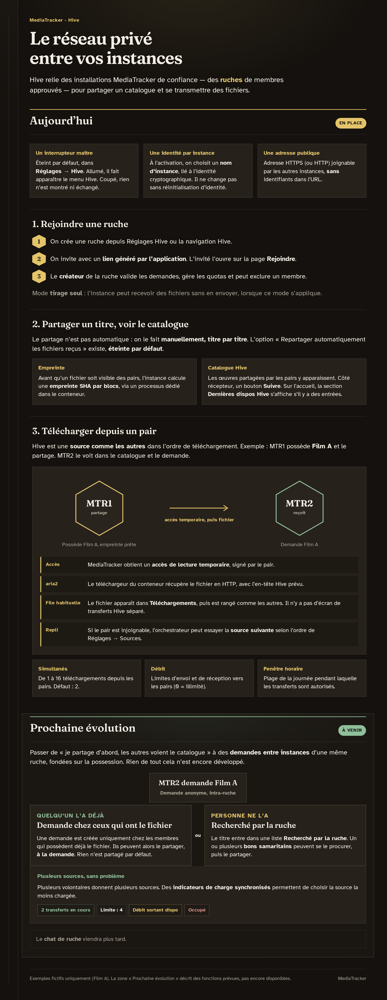
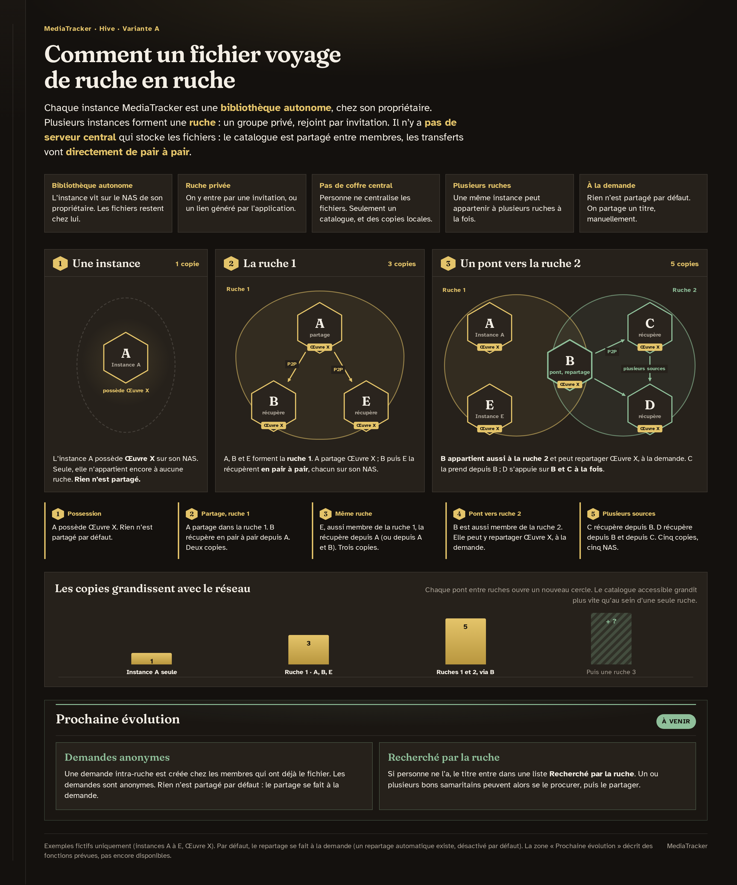
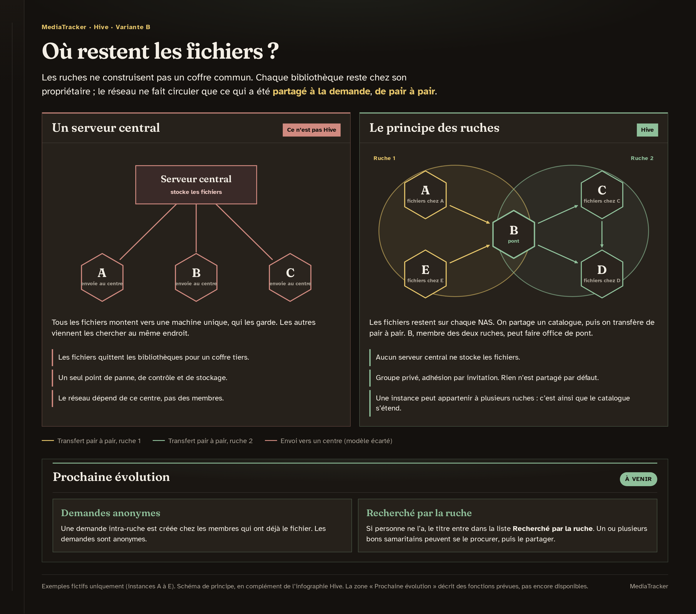

> Instantané public de MediaTracker, commit source a7ea6b0. Le développement se fait ailleurs ; issues bienvenues, PR désactivées pour l'instant.

# MediaTracker

Application pour **un seul utilisateur** sur un NAS (souvent OpenMediaVault) : suivre des films et séries, chercher des liens, télécharger via AllDebrid, ranger les fichiers sur le disque et les faire apparaître dans Jellyfin. Interface web en français, thème sombre.

MediaTracker s’installe en une seule image Docker avec une interface unique, plus simplement qu’une pile d’outils du type Sonarr, Radarr et Prowlarr à configurer séparément.

**Documentation utilisateur (installation, réglages, exemples Compose) :** [`docs/README.md`](docs/README.md).

## À quoi ça sert

- Suivre des titres (TMDB) et récupérer des épisodes ou films depuis une source configurée
- Télécharger avec aria2 (dans le conteneur, non exposé sur le réseau)
- Ranger automatiquement dans vos dossiers Films / Séries
- Synchroniser avec Jellyfin (optionnel)
- Notifications (webhook Home Assistant, etc.)

Accès habituel sur le réseau local : `http://<ip-du-nas>:8080`. Derrière un proxy HTTPS, définissez `PUBLIC_URL` (ex. `https://mediatracker.example.com`, sans chemin) et configurez le proxy pour envoyer `X-Forwarded-Proto`.

## Hive (partage entre instances)

Hive relie plusieurs installations MediaTracker de confiance au sein d’une **ruche** pour partager un catalogue et se transmettre des fichiers. Le partage se fait manuellement, titre par titre (un repartage automatique existe, désactivé par défaut). Avant d’être visible des pairs, chaque fichier reçoit une **empreinte** ; le transfert passe par un accès temporaire au fichier, puis par **aria2** et la file **Téléchargements** habituelle.

Guide : [Hive](docs/hive.md).







### Prochaine évolution

Prévu :

- Possession et demandes entre instances d’une même ruche : rien n’est partagé par défaut, le partage se fait à la demande.
- Une demande intra-ruche est créée chez les membres qui ont déjà le fichier. Les demandes sont anonymes.
- Si personne ne l’a, le titre apparaît dans une liste **Recherché par la ruche**. Un ou plusieurs **bons samaritains** peuvent alors se le procurer, puis le partager (plusieurs volontaires = plusieurs sources).
- Des indicateurs de charge synchronisés (transferts en cours, limite, débit sortant disponible, occupé) permettent de choisir la source la moins chargée.
- Un chat de ruche est prévu plus tard.

## Installation avec Docker

Image publique : `ghcr.io/nico2511/mediatracker-hive:latest` (GitHub Container Registry).

1. Choisissez un fichier Compose dans ce dossier :
   - **`docker-compose.yml`** : MediaTracker seul (Jellyfin déjà installé ailleurs)
   - **`docker-compose.jellyfin.yml`** : MediaTracker + Jellyfin (linuxserver)
2. Remplacez `REMPLACER` et les chemins `/chemin/vers/...` par vos dossiers sur le NAS.
3. Copiez `.env.example` vers `mediatracker.env` si vous préférez un fichier d’environnement (optionnel avec le Compose fourni).
4. Générez `SECRET_KEY` :  
   `python -c "import secrets; print(secrets.token_urlsafe(32))"`
5. Lancez : `docker compose up -d` (ou `-f docker-compose.jellyfin.yml`).
6. Ouvrez `http://<ip-du-nas>:8080` et suivez l’assistant (mot de passe, TMDB, AllDebrid, Jellyfin, etc.).

**Important :** films, séries, téléchargements et corbeille doivent être sur **le même disque** (un seul montage `/data` ou chemins sur le même système de fichiers). Sinon le déplacement d’un fichier terminé peut échouer.

`PUID` / `PGID` : numéros d’utilisateur et de groupe POSIX pour les fichiers sur le NAS (`id -u` / `id -g`).

## Principaux réglages (environnement)

| Variable | Rôle |
| --- | --- |
| `SECRET_KEY` | Obligatoire. Chiffre les secrets en base ; ne pas changer après coup sans ressaisir les clés. |
| `PUBLIC_URL` | URL publique https (ou http) sans chemin. Alias accepté : `PUBLIC_BASE_URL`. |
| `MOVIES_DIR`, `SERIES_DIR` | Dossiers bibliothèque dans le conteneur (défaut sous `/data/media/...` si non définis). |
| `DOWNLOADS_DIR`, `TRASH_DIR` | Téléchargements et corbeille (créés au démarrage si besoin). |
| `JELLYFIN_URL`, `JELLYFIN_PATH_MAP` | Adresse Jellyfin et correspondance des chemins (`préfixe_jellyfin=chemin_mt;...`). |
| `FORWARDED_ALLOW_IPS` | IP du reverse proxy pour `X-Forwarded-*` (défaut `127.0.0.1`). |
| `COOKIE_SECURE` | `auto`, `true` ou `false` pour le cookie de session. |

Liste complète et commentaires : [`.env.example`](.env.example).

## Mise à jour

### Manuelle

```bash
docker compose pull
docker compose up -d
```

Les données restent dans les volumes `/config` et `/data`. Les migrations de base partent au démarrage.

### Watchtower (automatique)

MediaTracker peut demander à [Watchtower](https://watchtower.nickfedor.com/) de mettre à jour son image via l’API HTTP (Réglages → Mise à jour → **Mettre à jour maintenant**). MediaTracker **ne monte jamais** `docker.sock` : seul Watchtower y accède.

Un service Watchtower commenté figure dans `docker-compose.yml`. Copiez `WATCHTOWER_HTTP_API_TOKEN` dans Réglages → Jetons d’API → Watchtower, avec l’URL `http://watchtower:8080` sur le réseau du compose.

Détails : [docs/mises-a-jour.md](docs/mises-a-jour.md).

## Sauvegardes

Copies quotidiennes de la base dans `/config/backups/`. Gardez la même `SECRET_KEY` si vous restaurez une sauvegarde.

## Licence

Ce dépôt est distribué sous [GNU GPL version 3](LICENSE) (ou ultérieure). Copyright © 2026 nico2511.

L’image Docker inclut [aria2](https://aria2.github.io/) (téléchargements BitTorrent), un logiciel sous licence GNU GPL version 2 ou ultérieure, distinct du code MediaTracker embarqué dans la même image.

## Développement

Depuis la racine du dépôt :

```bash
python -m venv .venv && source .venv/bin/activate
pip install -e ".[dev]"
export SECRET_KEY="$(python -c 'import secrets; print(secrets.token_urlsafe(32))')"
export ADMIN_PASSWORD='mot-de-passe-test'
python -m mediatracker.bootstrap
python -m uvicorn mediatracker.api.app:app --host 0.0.0.0 --port 8080
```

Frontend : `cd frontend && npm install && npm run dev`.

```bash
ruff check backend tests
pytest -q
```

## Home Assistant

Voir [`homeassistant/README.md`](homeassistant/README.md). L’URL MediaTracker se met une seule fois dans `secrets.yaml` (`mediatracker_url`).

## Santé et dépannage

- Santé : écran dans l’app ou `GET /api/v1/health` (authentification requise).
- Conteneur : `GET /healthz` (public).
- Documentation API : `/api/docs` (session requise).

Si le conteneur est « unhealthy », vérifiez les droits sur `/config` (`PUID`/`PGID`) et les journaux : `docker logs mediatracker`.
