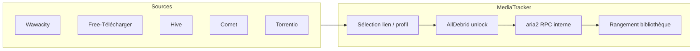

# MediaTracker — documentation pour assistants IA

MediaTracker est une application **mono-utilisateur** pour NAS (souvent OpenMediaVault) : suivre des films et
séries via TMDB, chercher des liens sur des sources configurées, télécharger via **AllDebrid** et **aria2** (RPC
interne au conteneur), ranger les fichiers sur le disque et les exposer à **Jellyfin** (optionnel). Notifications
via webhook (ex. Home Assistant). Interface web en français, thème sombre ; déploiement typique en **une image
Docker** (`ghcr.io/nico2511/mediatracker-hive`).

**Pile technique :** API **FastAPI** (Python 3.12+), base **SQLite**, workers et intégrations dans `backend/` ;
interface **Vue** dans `frontend/` ; conteneur unique avec aria2 non exposé sur le réseau.

**Parcours d’un téléchargement (résumé) :** un scan ou une action manuelle interroge les **sources** dans l’ordre
configuré ; le lien retenu respecte le **profil de qualité** et les préférences d’hébergeurs ; **AllDebrid** débloque
le lien ; **aria2** télécharge en local ; à la fin, le fichier est **déplacé** vers Films ou Séries (même système de
fichiers que les téléchargements), la bibliothèque est rescannée et Jellyfin peut être notifié.

Ce fichier est généré automatiquement à partir de `docs/` (hors interne, archives et exemples). Régénération :
`python scripts/build_ai_doc.py`.

## Sommaire

- [Installation](#docs-installation) — `docs/installation.md`
- [Premier démarrage](#docs-premier-demarrage) — `docs/premier-demarrage.md`
- [Chaîne de téléchargement](#docs-telechargements) — `docs/telechargements.md`
- [Réglages](#docs-reglages-README) — `docs/reglages/README.md`
- [Compte](#docs-reglages-compte) — `docs/reglages/compte.md`
- [Profils de qualité](#docs-reglages-qualite) — `docs/reglages/qualite.md`
- [Sources](#docs-reglages-sources) — `docs/reglages/sources.md`
- [Réglages de scan](#docs-reglages-scan) — `docs/reglages/scan.md`
- [Jellyfin](#docs-reglages-jellyfin) — `docs/reglages/jellyfin.md`
- [Notifications](#docs-reglages-notifications) — `docs/reglages/notifications.md`
- [Nettoyage](#docs-reglages-nettoyage) — `docs/reglages/nettoyage.md`
- [AllDebrid](#docs-reglages-alldebrid) — `docs/reglages/alldebrid.md`
- [Disque et sauvegardes](#docs-reglages-disque) — `docs/reglages/disque.md`
- [Hive](#docs-reglages-hive) — `docs/reglages/hive.md`
- [Application](#docs-reglages-application) — `docs/reglages/application.md`
- [Mise à jour et redémarrage](#docs-reglages-maj) — `docs/reglages/maj.md`
- [Jetons d'API](#docs-reglages-jetons) — `docs/reglages/jetons.md`
- [Réinitialiser la base](#docs-reglages-reset) — `docs/reglages/reset.md`
- [TMDB](#docs-tmdb) — `docs/tmdb.md`
- [Jellyfin](#docs-jellyfin) — `docs/jellyfin.md`
- [Hive](#docs-hive) — `docs/hive.md`
- [Home Assistant](#docs-home-assistant) — `docs/home-assistant.md`
- [Mises à jour](#docs-mises-a-jour) — `docs/mises-a-jour.md`
- [Sauvegarde et restauration](#docs-sauvegarde) — `docs/sauvegarde.md`
- [Dépannage et FAQ](#docs-depannage-faq) — `docs/depannage-faq.md`

## Installation

Chemin source : `docs/installation.md`

<a id="docs-installation"></a>

Ce guide décrit l’installation de MediaTracker avec **Docker** et **Docker Compose** sur un NAS ou un serveur Linux.

### Prérequis

- **Docker** et **Docker Compose** installés sur la machine hôte.
- Une image récupérable depuis le registre : `ghcr.io/nico2511/mediatracker-hive:latest`.
- Un disque (ou partage) pour le volume de **configuration** et un montage **unique** pour les **données** média (voir ci-dessous).

### Fichiers Compose fournis

À la racine du dépôt :

| Fichier | Usage |
| --- | --- |
| [`docker-compose.yml`](../docker-compose.yml) | MediaTracker seul |
| [`docker-compose.jellyfin.yml`](../docker-compose.jellyfin.yml) | MediaTracker + Jellyfin (linuxserver) sur le même réseau Compose |
| [Exemples commentés](exemples/README.md) | Variantes NAS, réseau externe, Watchtower, Hive multi-instances |

Exemples prêts à copier : dossier [`docs/exemples/`](exemples/).

### Volumes

```yaml
volumes:
  - /chemin/vers/mtr/config:/config
  - /chemin/vers/medias:/data
```

- **`/config`** : base SQLite (`app.db`), journaux rotatifs, sauvegardes quotidiennes, fichier `aria2.secret`, cache d’affiches TMDB.
- **`/data`** : bibliothèque, dossier de téléchargements et corbeille — **tout sur le même montage**.

`PUID` / `PGID` : identifiants utilisateur et groupe pour les fichiers créés dans le conteneur (`id -u` / `id -g` sur l’hôte).

### Variables d’environnement obligatoires et utiles

Copiez [`.env.example`](../.env.example) vers un fichier non versionné (ex. `mediatracker.env`) ou définissez les variables dans Compose.

| Variable | Rôle |
| --- | --- |
| `SECRET_KEY` | Obligatoire (≥ 16 caractères). Chiffre les secrets en base. Ne pas changer sans ressaisir les clés. Génération : `python -c "import secrets; print(secrets.token_urlsafe(32))"` |
| `ADMIN_USERNAME` / `ADMIN_PASSWORD` | Optionnels : si vide, l’assistant crée le compte. |
| `SETUP_TOKEN` | Optionnel : jeton exigé pour le premier compte ; sinon généré au démarrage (voir journaux). |
| `MOVIES_DIR`, `SERIES_DIR`, `DOWNLOADS_DIR`, `TRASH_DIR` | Chemins **dans le conteneur** ; surcharge des défauts sous `/data`. |
| `JELLYFIN_URL`, `JELLYFIN_PATH_MAP` | Pré-remplissage Jellyfin (sinon saisi dans l’assistant ou Réglages). |
| `PUBLIC_URL` | URL publique sans chemin (`https://mediatracker.example.com`). Alias : `PUBLIC_BASE_URL`. |
| `FORWARDED_ALLOW_IPS` | IP du reverse proxy pour `X-Forwarded-*` (défaut `127.0.0.1`). |
| `COOKIE_SECURE` | `auto`, `true` ou `false` pour le cookie de session. |
| `TZ`, `PUID`, `PGID`, `UMASK` | Fuseau et droits fichiers. |

Les clés **TMDB**, **AllDebrid**, **Jellyfin** et les jetons Watchtower ne doivent **pas** figer dans un compose versionné : saisissez-les dans l’assistant ou **Réglages** (chiffrés ensuite).

Au **premier démarrage**, les réglages listés dans `settings_store.SETTING_SPECS` sont copiés depuis l’environnement vers la base ; les modifications ultérieures se font dans l’UI (sauf secrets uniquement en env si non encore créés en base).

Liste commentée complète : [`.env.example`](../.env.example) et [exemples `.env`](exemples/env.example).

### Démarrage

```bash
docker compose up -d
## ou
docker compose -f docker-compose.jellyfin.yml up -d
```

Ouvrez `http://<hôte>:8080`. Si aucun compte n’existe, l’assistant redirige vers `/configuration`.

### Points de contrôle

- Santé publique du conteneur : `GET /healthz`
- Santé applicative (session requise) : page **Santé** ou `GET /api/v1/health`
- Documentation OpenAPI : `/api/docs` (session requise)

Suite : [Premier démarrage](#docs-premier-demarrage).

## Premier démarrage

Chemin source : `docs/premier-demarrage.md`

<a id="docs-premier-demarrage"></a>

### Assistant de configuration

Route : `/configuration` (accessible sans session tant qu’aucun compte n’existe, ou pour terminer l’assistant).

Étapes affichées dans l’interface :

1. **Mot de passe** — création du compte `admin` (ou `ADMIN_USERNAME`) ; `setup_token` si le serveur l’exige.
2. **Dossiers** — `media_dir`, films, séries, téléchargements, corbeille ; avertissement si les chemins ne sont pas sur le même volume.
3. **AllDebrid** — clé API (optionnelle à ce stade, stockée chiffrée).
4. **TMDB** — jeton de lecture API v4.
5. **Jellyfin** — URL, clé API, utilisateur, correspondance de chemins.
6. **Sources** — URLs optionnelles des sources de liens (voir ci-dessous). Bouton **Passer** : rien n’est modifié.
7. **Home Assistant** — webhook optionnel (URL + identifiant de webhook).
8. **Terminer** — récapitulatif du scan initial.

#### Étape Sources

Champs **tous optionnels** ; une valeur vide laisse le réglage actuel ou le défaut du conteneur :

| Champ assistant | Stockage (même clé que Réglages → Sources) |
| --- | --- |
| Wawacity | `wawacity_base_url` |
| Free-Télécharger | URL dans la fiche fournisseur `free_telecharger` (pas de clé SQLite dédiée) |
| Comet (une ligne par instance) | `comet_base_urls` |
| Torrentio | `torrentio_base_url` |

Validation : chaque adresse renseignée doit commencer par `http://` ou `https://`. **Tester Wawacity** appelle le même test que dans l’assistant historique (`POST /api/v1/setup/probe`). Enregistrement groupé : `POST /api/v1/setup/sources`.

Hive n’a pas d’URL de base (activation et adresse publique dans **Réglages → Hive**).

Si un mot de passe administrateur existe déjà (variable `ADMIN_PASSWORD` au démarrage), l’assistant commence à l’étape **Dossiers** après connexion.

#### Jeton d’installation (`SETUP_TOKEN`)

Sans compte et sans `SETUP_TOKEN` en variable d’environnement, MediaTracker génère un jeton au démarrage et l’écrit dans les **journaux** (niveau WARNING), du type :

```text
Aucun compte administrateur : pour créer le premier compte via l'assistant,
saisissez le jeton d'installation suivant (ou définissez SETUP_TOKEN pour le fixer) : …
```

Définir `SETUP_TOKEN` dans l’environnement fixe ce jeton et évite de le chercher dans les logs.

### Première connexion

- URL : `http://<hôte>:8080/login`
- Après l’assistant : accueil, **Suivre** (TMDB), **Téléchargements**, **Bibliothèque**, **Réglages**.

### Réglages complémentaires

Tout ce qui n’est pas dans l’assistant se configure dans **Réglages** — voir [l’index des sections](#docs-reglages-README) :

- Ordre et activation des **sources** (`/reglages/sources`)
- **Profils de qualité** et repli global
- **Hive** (désactivé par défaut)
- **Watchtower** et jetons GHCR (`/reglages/jetons`, `/reglages/maj`)

### PWA

**Réglages → Application** propose d’installer MediaTracker comme application (navigateur compatible).

## Chaîne de téléchargement

Chemin source : `docs/telechargements.md`

<a id="docs-telechargements"></a>

### Vue d’ensemble



1. Un **scan** ou une action manuelle interroge les sources dans l’**ordre** défini (`download_source_order`).
2. Le lien retenu respecte le **profil de qualité** de la fiche, la **préférence d’hébergeurs** et les hébergeurs refusés par l’application (`BLOCKED_SOURCE_HOSTERS` — non configurables).
3. **AllDebrid** débloque le lien ; MediaTracker ne expose **pas** aria2 sur le réseau (RPC local + secret en `/config`).
4. À la fin, le fichier est **déplacé** vers Films / Séries (structure façon Jellyfin), la bibliothèque est rescannée, Jellyfin peut être notifié.

Page **Téléchargements** : file des jobs, progression aria2, actions d’annulation / relance selon l’état.

### Sources disponibles

Identifiants dans l’UI (**Réglages → Sources**) :

| Id | Rôle |
| --- | --- |
| `wawacity` | Scraping HTML ; URL de base requise |
| `free_telecharger` | Scraping ; URL via fiche fournisseur |
| `hive` | Pairs des ruches ; nécessite Hive activé et membre joignable |
| `comet` | Instance(s) Comet (liste d’URLs, défaut public possible) |
| `torrentio` | Torrentio / aimants |

Ordre par défaut (code) : `wawacity,free_telecharger,hive,comet,torrentio`. Au moins une source doit rester activée.

Réglages communs : délai entre requêtes (`source_request_delay_seconds`), cache (`source_cache_seconds`), backoff après erreur (`source_error_backoff_min`), délai entre recherches distantes par fiche (`remote_search_cooldown_hours`, voir [Sources](#docs-reglages-sources)), ordre des **hébergeurs** (`hoster_preference`).

#### Wawacity — films

Pour un **film**, la découverte passe d’abord par une recherche **sans filtre de liste** (`plain_search_url`) : titre français (avec `year=` quand l’année TMDB est connue, puis la même requête **sans** année), puis le titre original si besoin. Les **séries** conservent le modèle par listes `s=`.

Sur une fiche Wawacity ouverte, si l’en-tête ne correspond pas au profil de la fiche, le moteur peut ouvrir une **version sœur** proposée dans le bloc **« Autres qualités »** (qualité et langue lues sur le bouton, titre et année repris de la fiche courante).

### Journal des tentatives par source

Chaque passage sur une source pendant un job de téléchargement peut créer ou mettre à jour un événement **`download.source_attempt`** (un enregistrement par couple téléchargement × source). Le détail affiché reprend des libellés du type :

- `Wawacity : N lien(s) trouvé(s).`
- `Wawacity : aucun résultat.`
- `Wawacity : refusé (filtre profil).` (ou autre motif, ex. filtre de taille)
- `Comet : refusé (Aucun flux Comet ne correspond au profil « … ».)` lorsque les flux ne passent pas le profil
- `… : ignoré (…)` ou `… : erreur (…)`

Lorsque plusieurs sources ont été essayées dans le même passage, le message d’échec du job peut **concaténer** une ligne par source (séparateur ` · `). En l’absence de liens Wawacity en base, le worker peut **réveiller** un sondage source immédiat au lieu d’appliquer seul le long recul après erreur.

### Hive dans la file Download

Depuis la standardisation LOT4, un téléchargement Hive passe par la **même file** qu’un lien AllDebrid : octroi pair (`fetch-grant`) et téléchargement HTTP via aria2 avec en-têtes dédiés — **pas** d’onglet « transferts » séparé ni de `HiveTransferJob` actif. Détails : [Hive](#docs-hive).

### AllDebrid

- Clé API : assistant ou **Réglages → AllDebrid** (bloc compte + PIN éventuel).
- **Purger après dépôt** : retire le lien / l’aimant du compte une fois le fichier rangé (défaut activé).
- Téléchargements **manuels** : possible depuis une fiche si l’URL est autorisée (certains hébergeurs sont refusés côté serveur).

### aria2

- Processus dans le conteneur MediaTracker ; secret `aria2_rpc_secret` généré et écrit dans `/config/aria2.secret`.
- Alerte si aria2 reste injoignable pendant les téléchargements (`aria2_unreachable_alert_min`, défaut 15 minutes).

### Rangement « façon Jellyfin »

Après téléchargement réussi :

- Film : dossier sous le chemin **films** configuré.
- Série : structure saison / épisode sous le chemin **séries**.
- **Repasse bibliothèque** planifiée (`library_scan_interval_hours`) et après chaque dépôt.

**Réglages de scan** : chemins absolus, action après téléchargement (`archive` ou `remove` dans la liste UI uniquement — le fichier disque reste).

### Corbeille et suppression automatique

- Fichiers supprimés ou auto-nettoyés vont dans `trash_dir` (même volume que la bibliothèque).
- **Nettoyage** : suppression auto après visionnage, préavis, rétention corbeille — voir [reglages/nettoyage.md](#docs-reglages-nettoyage).
- **Disque** : pause des téléchargements si espace libre sous le seuil (`disk_min_free_gb`, `0` désactive).

### Nouveautés catalogue

Worker séparé : films/séries « nouveautés » selon `catalog_interval_hours`, filtres qualité/langue, rétention `catalog_retention_days` (réglages en base, pas de page dédiée dans l’index Réglages — modifiable via API / env au premier boot).

Voir aussi : [Sources](#docs-reglages-sources), [Scan](#docs-reglages-scan), [AllDebrid](#docs-reglages-alldebrid).

## Réglages

Chemin source : `docs/reglages/README.md`

<a id="docs-reglages-README"></a>

Dans l’application : **Réglages** → choisir une section, ou URL directe `http://<hôte>:8080/reglages/<slug>`.

Les clés listées correspondent à `SETTING_SPECS` dans le code (`backend/mediatracker/settings_store.py`). Les valeurs affichées en UI priment sur l’environnement après le premier enregistrement.

| Slug | Titre dans l’UI | Documentation |
| --- | --- | --- |
| `compte` | Compte | [compte.md](#docs-reglages-compte) |
| `qualite` | Profils de qualité | [qualite.md](#docs-reglages-qualite) |
| `sources` | Sources | [sources.md](#docs-reglages-sources) |
| `scan` | Réglages de scan | [scan.md](#docs-reglages-scan) |
| `jellyfin` | Jellyfin | [jellyfin.md](#docs-reglages-jellyfin) |
| `notifications` | Notifications | [notifications.md](#docs-reglages-notifications) |
| `nettoyage` | Nettoyage | [nettoyage.md](#docs-reglages-nettoyage) |
| `alldebrid` | AllDebrid | [alldebrid.md](#docs-reglages-alldebrid) |
| `disque` | Disque et sauvegardes | [disque.md](#docs-reglages-disque) |
| `hive` | Hive | [hive.md](#docs-reglages-hive) |
| `application` | Application | [application.md](#docs-reglages-application) |
| `maj` | Mise à jour et redémarrage | [maj.md](#docs-reglages-maj) |
| `jetons` | Jetons d'API | [jetons.md](#docs-reglages-jetons) |
| `reset` | Réinitialiser la base | [reset.md](#docs-reglages-reset) |

Réglages Hive détaillés côté usage : [../hive.md](#docs-hive).

## Compte

Chemin source : `docs/reglages/compte.md`

<a id="docs-reglages-compte"></a>

URL : `/reglages/compte`

- Changement de mot de passe (8 caractères minimum, mot de passe actuel requis).
- **Déconnecter toutes les autres sessions** : invalide les cookies sur les autres navigateurs ; la session courante reste active.

## Profils de qualité

Chemin source : `docs/reglages/qualite.md`

<a id="docs-reglages-qualite"></a>

URL : `/reglages/qualite`

### Repli global

- **`allow_fallback`** : valeur par défaut pour les nouvelles fiches (le repli par fiche peut différer).
- **`profile_fallback_order`** : ordre des profils de qualité essayés après l’échec du profil principal (liste d’ids TMDB internes).

### Profils

Chaque profil définit : nom, langues ordonnées, résolution min/max, taille min/max (Mo), mots exclus dans le nom de fichier. Un profil peut être **défaut**. Wawacity, Comet et Hive utilisent le même profil pour une fiche, y compris lors d’un contrôle source immédiat.

Langues acceptées : VFF, VFQ, VF, MULTI, VOSTFR, VO (TRUEFRENCH enregistré comme VFF).

### Profils intégrés

Au premier démarrage, la base reçoit une liste de profils intégrés. Les mises à jour ultérieures **ajoutent** seulement un profil intégré encore absent (sans réécrire un profil que vous avez déjà modifié).

| Nom | Rôle |
| --- | --- |
| **VF/Multi 1080p** | Profil **défaut** sur une **nouvelle** base : min et max à **1080p** strict (migration initiale et défaut code). |
| 4K Multi | 4K, langues MULTI/VFF/VF |
| 720p VF | HD (720p) |
| VOSTFR 1080p | VOSTFR, plafond 1080p |
| Meilleure dispo | Pas de borne de résolution |
| **HDLight VF/Multi** | Cible **HDLight1080** uniquement (HDLight 1080p), langues VFF/VFQ/VF/MULTI |

Dans le formulaire, les résolutions proposées incluent **HDLight** (720p léger historique), **HD** (720p), **HDLight1080**, **1080p** et **4K**.

### Échelle des résolutions

Le moteur classe les résolutions du plus bas au plus haut : SD, HDLight, HD, **HDLight1080**, 1080p, 4K. Une sortie HDLight 1080p est donc **au-dessus** du HD 720p, mais **en dessous** du 1080p « plein » pour le profil par défaut (qui exige 1080p et rejette HDLight1080).

## Sources

Chemin source : `docs/reglages/sources.md`

<a id="docs-reglages-sources"></a>

URL : `/reglages/sources`

Les mêmes URLs peuvent être préremplies à l’**étape Sources** de l’assistant (`/configuration`) ; voir [Premier démarrage — Sources](#docs-premier-demarrage).

### Ordre et activation

- **`download_source_order`** : liste ordonnée parmi `wawacity`, `free_telecharger`, `hive`, `comet`, `torrentio`. Au moins une source doit rester cochée.
- État en ligne / panne : API `GET /api/v1/settings/sources/status` (affiché dans la page).

### Rythme et cache

| Clé | Défaut (env) | Plage | Rôle |
| --- | --- | --- | --- |
| `source_request_delay_seconds` | 5 | 2–60 | Pause entre requêtes HTTP vers les sources |
| `source_cache_seconds` | 900 | 0–3600 | Cache des résultats de recherche |
| `source_error_backoff_min` | 180 | 30–1440 | Repousse après erreur source |
| `remote_search_cooldown_hours` | 6 | 1–72 | Délai entre deux recherches distantes d'une même fiche |

`remote_search_cooldown_hours` est réglable dans **Réglages → Sources**, section **Rythme des requêtes** (1 à 72 h, défaut 6). Il s’applique **par fiche** via `last_remote_search_at` : une nouvelle recherche distante n’est acceptée qu’après ce délai depuis la dernière qui a consommé le quota. Concernent notamment le **retéléchargement** sans lien vivant, les passages **REDISCOVER**, le **repli de version** et la **relecture source** d’une réparation lorsqu’une recherche réseau est nécessaire — **y compris si l’action est déclenchée à la main** (pas de dérogation). Un sondage qui se contente des pages déjà liées en base n’écrit pas ce quota.

### Hébergeurs (liens débrid)

- **`hoster_preference`** : ordre CSV des hébergeurs acceptés pour les liens HTML. Certains hébergeurs sont **refusés** par le serveur sans réglage utilisateur.

### URLs par source

| Clé | Source |
| --- | --- |
| `wawacity_base_url` | Wawacity (obligatoire pour scanner) |
| `wawacity_user_agent` | User-Agent optionnel |
| `free_telecharger_user_agent` | Free-Télécharger (URL via fiche fournisseur en base) |
| `torrentio_base_url` | Torrentio (défaut `https://torrentio.strem.fun`) |
| `comet_base_urls` | Liste d’instances Comet (une par ligne) ; `comet_base_url` garde la première |

Migration de domaine Wawacity : bannière et actions **Accepter / Rétablir** si une redirection est proposée (`wawacity_domain_propose_only` en env au premier boot).

### Test de source

Bloc **Tester une source** : titre optionnel et identifiant IMDb optionnel.

- **Tester** (sur une carte source) ou **Tester toutes** : une requête témoin par source activée ; aucun téléchargement n’est lancé.
- Chaque carte affiche le **dernier test** : horodatage, issue (`trouvé`, `aucun résultat`, `erreur`, `refusée`, etc.), motif éventuel et durée en ms.
- Un test manuel qui aboutit à « aucun résultat » remet la source **en ligne** et efface un ancien état de panne lié à ce test.

### Hive

Si Hive est activé et que vous appartenez à des ruches, la ligne d’état Hive affiche le nombre de ruches.

Voir [Chaîne de téléchargement](#docs-telechargements).

## Réglages de scan

Chemin source : `docs/reglages/scan.md`

<a id="docs-reglages-scan"></a>

URL : `/reglages/scan`

### Scan des sources (séries / films suivis)

| Clé | Défaut | Plage | Rôle |
| --- | --- | --- | --- |
| `scan_interval_min` | 720 | 60–10080 | Intervalle entre scans (minutes) |
| `scan_ongoing_only` | true | bool | Ne repoller que les séries encore en cours |
| `scan_air_window_days` | 3 | 0–30 | Fenêtre autour de la date de diffusion (séries) |
| `film_theatrical_fallback_months` | 4 | 0–24 | Mois après sortie salle si TMDB sans date numérique |

L’ordre des sources se règle dans [Sources](#docs-reglages-sources).

### Chemins (absolus dans le conteneur)

| Clé | Défaut si vide (`DATA_DIR=/data`) |
| --- | --- |
| `media_dir` | `/data/media` |
| `library_movies_path` | `/data/media/Films` (surcharge env `MOVIES_DIR`) |
| `library_series_path` | `/data/media/Series` (surcharge env `SERIES_DIR`) |
| `downloads_dir` | `/data/downloads` |
| `trash_dir` | `/data/.trash` |

L’UI affiche les chemins **en vigueur** et un **warning** si les volumes ne permettent pas les renommages atomiques.

### Bibliothèque disque

| Clé | Défaut | Rôle |
| --- | --- | --- |
| `library_scan_interval_hours` | 24 | Repasse planifiée (1–168 h) |
| `library_scan_enabled` | true | Active la repasse automatique |
| `library_auto_follow` | false | Suivre automatiquement après identification TMDB |
| `downloads_completed_action` | `archive` | `archive` ou `remove` dans la liste Téléchargements (fichier conservé) |
| `auto_download_default` | true | Téléchargement auto pour les nouveaux suivis |

## Jellyfin

Chemin source : `docs/reglages/jellyfin.md`

<a id="docs-reglages-jellyfin"></a>

URL : `/reglages/jellyfin`

Voir le guide [Jellyfin](#docs-jellyfin). Clés : `jellyfin_url`, `jellyfin_api_key`, `jellyfin_user_id`, `jellyfin_path_map`, `jellyfin_path_prefix`, `jellyfin_auto_rename`, `jellyfin_push_watched`, `jellyfin_poll_interval_min`, `jellyfin_webhook_secret` (généré, affiché pour plugin webhook).

## Notifications

Chemin source : `docs/reglages/notifications.md`

<a id="docs-reglages-notifications"></a>

URL : `/reglages/notifications`

| Clé | Rôle |
| --- | --- |
| `public_base_url` | Lien vers la fiche dans les messages (souvent URL LAN) |
| `notify_group_seconds` | Regroupe les fin de téléchargement (0 = désactivé) |
| `notify_quiet_start` / `notify_quiet_end` | Heures calmes `HH:MM`, fuseau `notify_timezone` (défaut Europe/Paris) |

Cibles : **Home Assistant** (webhook sans HMAC), **ntfy**, **webhook signé** HMAC-SHA256. Événements sélectionnables par cible (nouveautés décoché par défaut à la création).

## Nettoyage

Chemin source : `docs/reglages/nettoyage.md`

<a id="docs-reglages-nettoyage"></a>

URL : `/reglages/nettoyage`

| Clé | Défaut | Plage | Rôle |
| --- | --- | --- | --- |
| `incomplete_cleanup_enabled` | false | bool | Corbeille pour incomplets / orphelins (après aperçu Bibliothèque) |
| `auto_delete_enabled` | true | bool | Suppression auto du contenu vu |
| `auto_delete_days` | 14 | 1–365 | Délai après visionnage |
| `cleanup_notice_hours` | 24 | 1–168 | Préavis notification |
| `trash_retention_days` | 7 | 1–90 | Rétention en corbeille avant purge |

UI : aperçu prochain passage, liste corbeille (restaurer / supprimer définitif).

## AllDebrid

Chemin source : `docs/reglages/alldebrid.md`

<a id="docs-reglages-alldebrid"></a>

URL : `/reglages/alldebrid`

- Bloc **compte** : clé API, état PIN si utilisé (`alldebrid_pin_session` côté serveur).
- **`alldebrid_auto_purge`** : après rangement réussi, retire lien / historique / aimant lié au job (défaut activé).
- Boutons **Purger AllDebrid** (liens des jobs terminés) et **Tout purger** (historique récent entier, avec confirmation).

La clé peut être préfixée via env `ALLDEBRID_API_KEY` au premier boot.

## Disque et sauvegardes

Chemin source : `docs/reglages/disque.md`

<a id="docs-reglages-disque"></a>

URL : `/reglages/disque`

| Clé | Défaut | Plage | Rôle |
| --- | --- | --- | --- |
| `disk_min_free_gb` | 5 | 0–1024 | Pause téléchargements si espace libre insuffisant (`0` = off) |
| `backup_keep` | 7 | 1–90 | Sauvegardes SQLite quotidiennes dans `/config/backups` |

Carte espace disque (données et config). Bloc **Sauvegarde / restauration** de la base.

Voir [Sauvegarde](#docs-sauvegarde).

## Hive

Chemin source : `docs/reglages/hive.md`

<a id="docs-reglages-hive"></a>

URL : `/reglages/hive`

Page composant dédié (pas dans `SettingsSectionView`).

Réglages persistés : `hive_enabled`, `hive_public_address`, `hive_instance_name` (via activation), `hive_catalog_auto_share`, `hive_transfer_parallel`, `hive_transfer_send_bps`, `hive_transfer_recv_bps`, `hive_transfer_window_start`, `hive_transfer_window_end`.

Guide utilisateur : [Hive](#docs-hive).

## Application

Chemin source : `docs/reglages/application.md`

<a id="docs-reglages-application"></a>

URL : `/reglages/application`

Propose l’**installation PWA** (Progressive Web App) lorsque le navigateur expose l’événement `beforeinstallprompt`. Hors ligne partiel : file d’ids TMDB selon l’implémentation PWA du frontend.

## Mise à jour et redémarrage

Chemin source : `docs/reglages/maj.md`

<a id="docs-reglages-maj"></a>

URL : `/reglages/maj`

- Affiche version, SHA image, date de build, dernière vérification GHCR/GitHub.
- **Vérifier la mise à jour** : compare au registre (jetons dans [Jetons](#docs-reglages-jetons)).
- **Mettre à jour maintenant** : délègue à Watchtower si `watchtower_url` + `watchtower_token` sont configurés.
- **Redémarrer** : redémarrage applicatif.
- **`notify_on_update`** : notification après mise à jour automatique Watchtower.

Voir [Mises à jour](#docs-mises-a-jour).

## Jetons d'API

Chemin source : `docs/reglages/jetons.md`

<a id="docs-reglages-jetons"></a>

URL : `/reglages/jetons`

### Secrets sortants (services distants)

| Clé | Usage |
| --- | --- |
| `ghcr_read_token` | Lecture métadonnées image GHCR (comparaison de version) |
| `github_update_token` | Repli : dernier commit sur `main` si GHCR absent |
| `watchtower_url` | Base URL API Watchtower (`http://watchtower:8080`) |
| `watchtower_token` | Bearer identique à `WATCHTOWER_HTTP_API_TOKEN` |

Secrets jamais réaffichés après enregistrement (chiffrement en base).

### Accès API (entrants)

Jetons `mt_…` créés dans l’UI : portées `read`, `write`, `admin`. Secret visible **une seule fois** à la création. Usage typique : Home Assistant, scripts LAN.

## Réinitialiser la base

Chemin source : `docs/reglages/reset.md`

<a id="docs-reglages-reset"></a>

URL : `/reglages/reset`

Efface fiches, téléchargements et index bibliothèque. Une copie SQLite est écrite dans `/config/backups` avant suppression. Les fichiers sur `/data` **ne sont pas** supprimés.

Confirmation textuelle : saisir `RESET`.

## TMDB

Chemin source : `docs/tmdb.md`

<a id="docs-tmdb"></a>

**TMDB** (*The Movie Database*) est un catalogue en ligne de films et séries. MediaTracker s’en sert en **lecture seule** pour afficher les affiches, les métadonnées et pour identifier vos fichiers sur le disque.

### Jeton API

MediaTracker appelle l’API TMDB v4 avec un **jeton de lecture** (`tmdb_read_token`) :

1. Créez un compte sur [themoviedb.org](https://www.themoviedb.org/settings/api).
2. Générez un jeton API en mode **lecture** (Read Access Token).
3. Saisissez-le dans l’assistant **TMDB** au premier démarrage, ou plus tard dans **Réglages**.

Le jeton est **chiffré** en base de données. Vous pouvez aussi le passer une fois en variable d’environnement au tout premier boot : `TMDB_READ_TOKEN` (voir [`.env.example`](../.env.example)).

### Dans l’application

| Écran | Rôle |
| --- | --- |
| **Accueil** (`/`) | Tableau de bord personnel et rangées de nouveautés TMDB (France, français) |
| **Derniers films** (`/nouveautes/films`) | Parcourir les films (cinéma, streaming, supports physiques) |
| **Dernières séries** (`/nouveautes/series`) | Séries et diffusions à l’antenne |
| **Suivre** | Rechercher un titre et l’ajouter à votre liste de suivi |
| Fiche média | Métadonnées, saisons, estimation de disponibilité pour les films |

Les anciennes URL d’essai `/tmdb`, `/tmdb/films` et `/tmdb/series` redirigent vers les écrans ci-dessus.

### Profils de qualité

Les critères de résolution, langue et mots à exclure pour **choisir un fichier** parmi les liens d’une source se règlent dans **Réglages → Profils de qualité** — voir [reglages/qualite.md](#docs-reglages-qualite).

### Corriger l’identifiant TMDB d’une série

Chaque fiche média est liée à un **identifiant numérique TMDB**. Si vous avez suivi la mauvaise série (homonyme, mauvaise saisie), vous pouvez le corriger depuis la fiche.

#### Première saisie

Lorsque la fiche n’avait **pas encore** d’identifiant TMDB, la nouvelle valeur est enregistrée immédiatement.

#### Remplacement sur une série qui en avait déjà un

Le serveur affiche d’abord un **aperçu** des changements (saisons, épisodes, fichiers concernés). Rien n’est modifié tant que vous n’avez pas confirmé.

**Où aller :** fiche média → **Réglages** → **Identification** → **Corriger l’identifiant**.

**Trois choix possibles :**

| Action | Effet |
| --- | --- |
| **Reconstruire les épisodes** | Les lignes d’épisodes de l’ancien catalogue qui n’existent plus sous le nouvel identifiant sont retirées de la fiche. Les **fichiers sur le disque ne sont ni supprimés ni déplacés** ; ils apparaissent dans la bibliothèque en zone **À réviser**, avec la note « À réassocier », jusqu’à ce que vous les rattachez manuellement à un épisode. |
| **Conserver les épisodes** | Comportement plus permissif : les épisodes hors nouveau catalogue TMDB restent listés sur la fiche. |
| **Annuler** | Aucune modification. |

**À savoir :**

- Un simple **rafraîchissement** des métadonnées TMDB (même identifiant) ne déclenche pas ce flux.
- Les fichiers d’un autre titre portant le même numéro de saison/épisode (S01E05, etc.) **ne sont pas** rattachés automatiquement au nouveau catalogue.
- Tant qu’un fichier porte la note « À réassocier », le scan bibliothèque **ne le rattache pas** tout seul.

Pour un **film**, le changement d’identifiant reste une opération directe (pas d’aperçu 409).

## Jellyfin

Chemin source : `docs/jellyfin.md`

<a id="docs-jellyfin"></a>

**Jellyfin** est un serveur multimédia qui lit les fichiers vidéo de votre bibliothèque. MediaTracker peut y **déposer** les téléchargements terminés, **rafraîchir** les bibliothèques et synchroniser l’état **vu / non vu** dans les deux sens.

### Configuration

**Réglages → Jellyfin** (`/reglages/jellyfin`) :

- **URL** : adresse du serveur Jellyfin. Sur le même fichier Docker Compose, souvent `http://jellyfin:8096`.
- **Clé API** : tableau de bord Jellyfin → engrenage → **Clés API**.
- **Utilisateur** : compte Jellyfin dont l’état « vu » est synchronisé avec MediaTracker.
- **Correspondance des chemins** : paires `préfixe_jellyfin=chemin_dans_mediatracker`, séparées par `;`.  
  Exemple avec l’image linuxserver : `/data/movies=/data/Films;/data/tvshows=/data/Séries`.
- **Ancien préfixe** : valeur de secours si une correspondance ne couvre pas un chemin (`jellyfin_path_prefix`).
- **Renommage automatique** : désactivé par défaut ; renomme les dossiers déjà identifiés sans validation manuelle.
- **Pousser un vu manuel** : optionnel, désactivé par défaut.
- **Synchro « vu » (minutes)** : défaut 30 ; le **webhook** Jellyfin accélère la mise à jour si vous l’installez.

Compose d’exemple avec Jellyfin : [`docker-compose.jellyfin.yml`](../docker-compose.jellyfin.yml) et [exemples](exemples/README.md).

### Webhook Jellyfin → MediaTracker

L’interface affiche l’URL du webhook et un jeton (en-tête `X-MediaTracker-Token`, prioritaire sur `?token=`). Événements pris en charge : PlaybackStop, UserDataSaved, ItemAdded, ItemUpdated.

Après chaque fichier déposé, MediaTracker demande aussi un **rafraîchissement** de la bibliothèque Jellyfin (délai d’environ une minute).

### Bibliothèque locale

- **Bibliothèque** : scan des dossiers films / séries, identification TMDB.
- **Suivre automatiquement après identification** : réglage dans **Scan** (`library_auto_follow`, désactivé par défaut).
- **Repasse** : intervalle en heures, plus une repasse après chaque dépôt.

### Importer l’historique « vu » depuis Jellyfin

MediaTracker peut reprendre ce que vous aviez déjà marqué comme **vu** dans Jellyfin, sans rester connecté au serveur Jellyfin pendant l’import. Deux entrées dans **Bibliothèque → Importer l’historique** :

- onglet **Bases Jellyfin** (recommandé) ;
- onglet **Fichier CSV** (export préalable ou archivage).

#### Avant de copier des fichiers Jellyfin

Sur le serveur Jellyfin (ou une sauvegarde arrêtée), les données utiles se trouvent en général dans le répertoire de données Jellyfin, sous-dossier `data/` :

| Fichier | Rôle |
| --- | --- |
| `jellyfin.db` | Base principale (comptes, bibliothèque, marquages vus, journal d’activité) |
| Archive `.zip` (tableau de bord → Sauvegardes) | Export Jellyfin 10.11 avec fichiers JSON (`Users`, `UserData`, `BaseItems`, `ActivityLogs`, …) |

**Conseil :** arrêtez le conteneur Jellyfin ou travaillez sur une **copie** des fichiers. Les outils MediaTracker ouvrent les bases en **lecture seule**.

#### Parcours guidé (onglet Bases Jellyfin)

1. **Bibliothèque → Importer l’historique** → onglet *Bases Jellyfin*.
2. Envoyez une copie de **jellyfin.db** **ou** une archive **.zip** de sauvegarde Jellyfin 10.11.
3. Choisissez le **compte Jellyfin** à importer.
4. **Prévisualisation** : compteurs par source (bibliothèque, journal d’activité, éléments sans titre) et compteurs d’identification dans MediaTracker. Vous pouvez **télécharger le CSV** généré pour vos archives.
5. **Confirmer** : marquage « vu » avec la date d’origine ; création éventuelle de fiches **sans suivi automatique**.
6. **Réactiver le suivi** : case à cocher par titre du dernier import, puis **Appliquer le suivi**.

Les fichiers envoyés sont stockés temporairement dans le dossier de configuration MediaTracker, vérifiés (SQLite ou ZIP), puis **supprimés** après confirmation, abandon ou erreur. Les restes de plus de 24 h sont nettoyés au démarrage. Taille maximale par fichier : **1 Go** par défaut (réglage `JELLYFIN_HISTORY_UPLOAD_MAX_BYTES`).

Derrière un **proxy inverse**, augmentez la limite de taille des requêtes si besoin (par exemple `client_max_body_size` côté nginx).

#### Export CSV en ligne de commande (optionnel)

Depuis une machine avec Python 3, à la racine du dépôt :

```bash
python3 tools/jellyfin_history_export.py \
  --jellyfin-db /chemin/vers/copie/jellyfin.db \
  --user NomDuCompte \
  --out historique-jellyfin.csv
```

`--user` est facultatif s’il n’y a qu’un seul compte. Le parcours guidé dans l’interface s’appuie surtout sur le **journal d’activité** Jellyfin ; l’export CLI lit directement `jellyfin.db`.

Colonnes du CSV (UTF-8) : `type`, `title`, `year`, `series_title`, `season`, `episode`, identifiants externes (`tmdb_id`, etc.), `jellyfin_item_id`, `watched_at`, `play_count`, `source`.

#### Import CSV (onglet secondaire)

1. **Bibliothèque → Importer l’historique** → onglet *Fichier CSV*.
2. **Prévisualisation** puis **Confirmer** : même logique idempotente (réimporter le même fichier ne crée pas de doublons).
3. **Réactiver le suivi** : liste à cocher du **dernier** import uniquement.

Chaque import confirmé ajoute **une** entrée dans le journal applicatif, pas une par ligne.

### Dépannage

- L’écran **Santé** signale les dossiers sur des volumes différents ou des chemins incohérents.
- Boutons **Tester la connexion** et **Synchroniser les vus** dans **Réglages → Jellyfin**.

## Hive

Chemin source : `docs/hive.md`

<a id="docs-hive"></a>

**Hive** est le mode de **partage de catalogue** et de **téléchargement entre instances** MediaTracker qui appartiennent aux mêmes **ruches** (groupes de membres approuvés).

### Activation

**Réglages → Hive** (`/reglages/hive`) :

1. Activer l’interrupteur **Hive** (désactivé par défaut).
2. À la première activation, choisir un **nom d’instance** (lié à l’identité cryptographique ; ne change pas sans réinitialisation d’identité).
3. Renseigner l’**adresse publique** HTTPS (ou HTTP) joignable par les autres instances — par exemple `https://mtr.exemple.fr` — **sans** identifiants dans l’URL.

L’entrée de menu **Hive** n’apparaît que lorsque Hive est activé.

### Ruches et membres

- **Créer une ruche** : depuis Réglages Hive ou la navigation Hive.
- **Inviter** : lien d’invitation généré par l’application ; page **Rejoindre** (`/hive/rejoindre`).
- **Membres** (`/hive/ruches/<id>/membres`) : validation des demandes (créateur de la ruche), quotas, exclusion.

Le mode **tirage seul** (`pull_only`) : l’instance peut recevoir des fichiers sans en envoyer (affiché dans l’interface si applicable).

### Catalogue et partage

- **Catalogue Hive** : œuvres partagées par les pairs ; bouton **Suivre** côté récepteur.
- **Repartage automatique** : option **Repartager automatiquement les fichiers reçus** (`hive_catalog_auto_share`, **désactivée** par défaut).
- **Accueil** : section **Dernières dispos Hive** lorsque des entrées existent.

Avant qu’un fichier soit visible des pairs, l’instance calcule une **empreinte** (empreinte SHA par blocs du fichier) via un processus dédié dans le conteneur.

### Téléchargements

Hive est une **source** comme les autres dans l’ordre de téléchargement (`hive` dans `download_source_order`). Lorsqu’un fichier est disponible chez un pair :

1. MediaTracker obtient un **grant** de lecture temporaire, signé par le pair.
2. **aria2** (téléchargeur dans le conteneur) récupère le fichier en HTTP avec l’en-tête Hive prévu.
3. Le fichier apparaît dans **Téléchargements** puis est rangé comme un téléchargement AllDebrid classique.

Il n’y a **pas** d’écran de transferts Hive séparé : tout passe par la file **Téléchargements** habituelle.

Si le pair est injoignable, l’orchestrateur peut **essayer la source suivante** selon l’ordre configuré dans **Réglages → Sources**.

### Limites de débit et fenêtre horaire

Toujours dans **Réglages → Hive** :

| Réglage | Plage | Rôle |
| --- | --- | --- |
| `hive_transfer_parallel` | 1–16 | Téléchargements simultanés depuis les pairs (défaut 2) |
| `hive_transfer_send_bps` | 0–2e9 | Débit d’envoi vers les pairs (0 = illimité) |
| `hive_transfer_recv_bps` | 0–2e9 | Débit de réception |
| `hive_transfer_window_start` / `end` | minutes dans la journée | Fenêtre horaire autorisée |

### Identité illisible

Si la clé privée Hive ne peut plus être lue, l’interface bloque la plupart des réglages Hive jusqu’à **Réinitialiser l’identité** (bouton dans Réglages ou `POST /api/v1/hive/identity/reset`).

### Plusieurs instances sur un même réseau

Chaque instance doit avoir :

- une **`SECRET_KEY` distincte** ;
- des volumes **`/config`** et **`/data`** séparés ;
- une **adresse publique** distincte (souvent derrière un proxy inverse).

Exemple de fichier Compose : [exemples/docker-compose-deux-instances-hive.yml](exemples/docker-compose-deux-instances-hive.yml).

Pour des scénarios avancés (proxy multi-domaines, sandboxes), voir aussi [exemples/docker-compose-hive-sandbox.example.yml](exemples/docker-compose-hive-sandbox.example.yml).

## Home Assistant

Chemin source : `docs/home-assistant.md`

<a id="docs-home-assistant"></a>

MediaTracker peut être piloté depuis Home Assistant via un **jeton d’API** et le package YAML fourni dans le dépôt.

### Documentation détaillée

Tout le flux d’installation (package, secrets, tableaux de bord, HACS, thèmes optionnels) est dans :

**[homeassistant/README.md](../homeassistant/README.md)**

### Résumé

1. **Créer un jeton** dans MediaTracker : **Réglages → Jetons d’API → Accès API**, portée **write** (inclut la lecture).
2. Copier `homeassistant/mediatracker.yaml` vers `/config/packages/` sur Home Assistant.
3. Définir dans `secrets.yaml` :
   - `mediatracker_url` : schéma + hôte + port, **sans chemin** (ex. `http://192.0.2.10:8080`)
   - `mediatracker_token` : jeton `mt_…`
4. Activer les packages dans `configuration.yaml` : `packages: !include_dir_named packages`.
5. Importer le tableau de bord `homeassistant/dashboard.yaml` (ou un thème sous `homeassistant/dashboards/`).

### API utilisée par le package

- `GET /api/v1/ha/summary` (capteur REST, environ une fois par minute)
- `POST` divers pour suivre, vérifier les sources, file d’attente, etc. (voir le package)

### Notifications depuis MediaTracker

Pour envoyer des événements **vers** Home Assistant sans le package HA, ajoutez une cible **Home Assistant** dans **Réglages → Notifications** (URL du serveur + identifiant de webhook).

L’assistant de premier démarrage peut pré-configurer une cible HA si vous renseignez l’étape Home Assistant.

## Mises à jour

Chemin source : `docs/mises-a-jour.md`

<a id="docs-mises-a-jour"></a>

### Manuelle (recommandée sur NAS prudents)

```bash
docker compose pull
docker compose up -d
```

Les données dans `/config` et `/data` sont conservées ; les migrations SQLite s’exécutent au démarrage.

### Watchtower

MediaTracker **ne monte pas** `docker.sock`. Seul un conteneur **Watchtower** (ou équivalent) accède à Docker.

#### Configuration Watchtower

Variables courantes (conteneur Watchtower) :

- `WATCHTOWER_HTTP_API_UPDATE=true` — API HTTP pour déclencher une mise à jour.
- `WATCHTOWER_HTTP_API_TOKEN` — secret partagé avec MediaTracker.
- `WATCHTOWER_HTTP_API_PERIODIC_POLLS` / `WATCHTOWER_POLL_INTERVAL` — vérification périodique des images.
- `WATCHTOWER_CLEANUP=true` — supprimer les anciennes images.
- `WATCHTOWER_CONTAINER_NAMES=mediatracker` — ne surveiller que ce conteneur (recommandé en stack séparé).

Exemples : [exemples/](exemples/README.md).

#### Côté MediaTracker

**Réglages → Jetons d’API** :

- **URL Watchtower** — ex. `http://watchtower:8080` sur le réseau Docker partagé, ou l’URL joignable depuis le conteneur MediaTracker.
- **Jeton Watchtower** — identique à `WATCHTOWER_HTTP_API_TOKEN`.

**Réglages → Mise à jour et redémarrage** :

- Affiche la version / SHA de l’image courante et compare au registre GHCR (jeton **GHCR** optionnel) ou à GitHub (**jeton GitHub** en repli).
- **Mettre à jour maintenant** : `POST` vers `{watchtower_url}/v1/update?image=…` avec le jeton Bearer.
- **Redémarrer** : redémarrage du processus applicatif sans forcément retélécharger l’image.
- Option **Me notifier quand Watchtower installe une nouvelle version** (`notify_on_update`).

En cas d’erreur 401 : le jeton Watchtower ne correspond pas à celui du conteneur.

### Image suivie

L’image publique documentée est `ghcr.io/nico2511/mediatracker-hive:latest`, fixée au build via la variable d’environnement `MEDIATRACKER_UPDATE_IMAGE` (défaut dans l’image publique : `ghcr.io/nico2511/mediatracker-hive`). Le bouton **Mettre à jour maintenant** transmet à Watchtower cette image de référence ; la comparaison GHCR peut s’effectuer sans jeton pour une image publique.

## Sauvegarde et restauration

Chemin source : `docs/sauvegarde.md`

<a id="docs-sauvegarde"></a>

### Sauvegardes automatiques

- Copie quotidienne de la base SQLite dans **`/config/backups/`**.
- Rétention : **`backup_keep`** jours (défaut 7, plage 1–90) — **Réglages → Disque et sauvegardes**.
- Le cache d’affiches TMDB sous `/config/cache/images` **n’est pas** inclus dans ces sauvegardes SQLite.

### `SECRET_KEY`

Gardez la même **`SECRET_KEY`** si vous restaurez une sauvegarde ou copiez `/config` : sinon les secrets chiffrés en base (clés API, jetons) deviennent illisibles.

### Depuis l’interface

**Réglages → Disque et sauvegardes** : composant **Sauvegarde / restauration** de la base (export et import de fichier SQLite selon les actions exposées dans l’UI).

### Réinitialiser la base

**Réglages → Réinitialiser la base** : efface fiches, téléchargements et index bibliothèque après une copie de secours dans `backups/`. **Les fichiers sur `/data` ne sont pas supprimés.**

### Sauvegarde complète NAS

Pour une reprise sur autre machine :

1. Arrêter le conteneur.
2. Copier le volume **`/config`** (base, backups, aria2.secret).
3. Copier le volume **`/data`** (médias, téléchargements, corbeille sur le **même** montage).

Vérifiez `PUID`/`PGID` et chemins `MOVIES_DIR` etc. sur le nouvel hôte.

## Dépannage et FAQ

Chemin source : `docs/depannage-faq.md`

<a id="docs-depannage-faq"></a>

### Conteneur « unhealthy »

Vérifiez :

- Droits sur **`/config`** (`PUID` / `PGID`).
- `SECRET_KEY` défini.
- Journaux : `docker logs mediatracker`.

Endpoint public : `GET /healthz`.

### Déplacement de fichier après téléchargement échoue

**Cause fréquente** : téléchargements et bibliothèque sur des volumes Docker **différents** (pas de renommage atomique).

**Correctif** : un seul montage `/data` pour films, séries, téléchargements et corbeille — voir [Installation](#docs-installation).

La page **Santé** et l’assistant signalent un avertissement volume si les chemins sont incohérents.

### Téléchargements en pause

- Espace disque sous le seuil **`disk_min_free_gb`** (défaut 5 Go, `0` désactive).
- AllDebrid invalide ou quota.
- aria2 injoignable (alerte après `aria2_unreachable_alert_min` minutes).

### Sources en panne

**Réglages → Sources** : pastilles d’état, dernier test, message (domaine Wawacity, Cloudflare, etc.).

- Wawacity : mettre à jour l’**URL de base** ; proposition de migration de domaine si l’instance le détecte.
- Aucune source active : message bloquant les téléchargements.
- **Dernier test** sur chaque carte : horodatage et issue du dernier essai (aucun téléchargement lancé). **Tester toutes** enchaîne une requête témoin par source activée.

### Profil de qualité modifié : plus de liens utilisables

Les liens **déjà enregistrés** restent en base, mais le téléchargement les **refuse** s’ils ne passent plus le profil actuel de la fiche (journal : `refusé (filtre profil)` ou message équivalent côté Comet/Torrentio).

Pour **découvrir de nouvelles pages** côté source (retéléchargement sans lien vivant, REDISCOVER, repli de version, réparation avec recherche réseau), le délai **`remote_search_cooldown_hours`** (défaut 6 h, réglable 1–72 h dans **Réglages → Sources**) s’applique **par fiche**, y compris sur une action lancée à la main. Tant que le délai n’est pas écoulé, le message du type « Aucun lien disponible, nouvel essai plus tard » ou « Recherche source reportée (limite X h) » peut apparaître. Baisser **temporairement** ce réglage (par ex. 1 h) permet de relancer une recherche distante plus tôt, puis de remettre la valeur habituelle.

### Connexion / session

- Derrière HTTPS : `PUBLIC_URL` et `FORWARDED_ALLOW_IPS` / `COOKIE_SECURE`.
- Verrouillage après échecs : `LOGIN_RATE_LIMIT`, fenêtre et durée `LOGIN_LOCKOUT_SECONDS`.

### Hive

- Pair injoignable : repli vers une autre source ; vérifier **`hive_public_address`** et le reverse proxy.
- **Identité perdue** : réinitialisation d’identité dans Réglages Hive.

### Mise à jour Watchtower

- « Watchtower injoignable » : URL réseau depuis le conteneur MediaTracker.
- « Jeton refusé » : aligner **Jetons d’API → Jeton Watchtower** et `WATCHTOWER_HTTP_API_TOKEN`.

### Où sont les journaux applicatifs ?

Rotatifs sous **`/config/logs/`** (`LOG_MAX_BYTES`, `LOG_BACKUP_COUNT` en env).

### API et intégrations

- OpenAPI : `/api/docs` (session requise).
- Home Assistant : [home-assistant.md](#docs-home-assistant).

### TMDB / identifiants

Pour corriger l’identifiant TMDB d’une **série** déjà suivie (aperçu, reconstruction ou conservation des épisodes), voir [TMDB — Corriger l’identifiant](#docs-tmdb-corriger-lidentifiant-tmdb-dune-serie).
