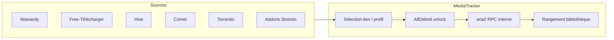

# Chaîne de téléchargement

## Vue d’ensemble

1. Un **scan** ou une action manuelle interroge les sources dans l’**ordre** défini (`download_source_order`), d’abord celles qui publient des **pages de liens** (Wawacity, Free-Télécharger, etc.).
2. Si aucune page « liens » n’est retenue pour la fiche, un **repli scan** (activé par défaut, `scan_episode_sources_fallback`) peut interroger les sources **épisode** (Comet, Torrentio, addons Stremio) pour les épisodes ou le film attendus, via l’identifiant **IMDb** et le **profil** de la fiche (mêmes critères que le déblocage Comet/Torrentio). Les aimants retenus sont ceux déjà signalés **en cache** chez AllDebrid lorsque le débrideur expose ce contrôle ; un job `pending` est alors créé comme pour un lien hoster découvert au scan. Le repli respecte `remote_search_cooldown_hours` et l’ordre global des sources.
3. Le lien retenu respecte le **profil de qualité** de la fiche, la **préférence d’hébergeurs** et les hébergeurs refusés par l’application (`BLOCKED_SOURCE_HOSTERS` — non configurables).
4. **AllDebrid** débloque le lien ; MediaTracker ne expose **pas** aria2 sur le réseau (RPC local + secret en `/config`).
5. À la fin, le fichier est **déplacé** vers Films / Séries (structure façon Jellyfin), la bibliothèque est rescannée, Jellyfin peut être notifié.

Page **Téléchargements** : file des jobs, progression aria2, actions d’annulation / relance selon l’état.

## Proposition de version principale

Si un fichier local vient d’un **profil de repli**, un contrôle source ordinaire peut constater qu’une version du **profil principal** est déjà référencée (cache de liens ou catalogue Hive), sans recherche réseau dédiée. La fiche média affiche un bandeau **Remplacer** / **Ignorer**. Le remplacement réutilise la file téléchargement (`forced`) ; l’ancien fichier n’est envoyé à la corbeille qu’après rangement réussi du nouveau. Voir [Profils de qualité — Remplacement proposé](reglages/qualite.md#remplacement-proposé-repli--principal).

## Sources disponibles

Identifiants dans l’UI (**Réglages → Sources**) :

| Id | Rôle |
| --- | --- |
| `wawacity` | Scraping HTML ; URL de base requise |
| `free_telecharger` | Scraping ; URL via fiche fournisseur |
| `hive` | Pairs des ruches ; nécessite Hive activé et membre joignable |
| `comet` | Instance(s) Comet (liste d’URLs, défaut public possible) |
| `torrentio` | Torrentio / aimants |
| `stremio_addons` | Une ou plusieurs URLs d’addons Stremio (torrents et liens débridables selon la réponse de l’addon ; sans clé dans l’URL) |

Ordre par défaut (code) : `wawacity,hive,comet,torrentio,stremio_addons`. Au moins une source doit rester activée. Free-Télécharger reste disponible, désactivé par défaut ; on l’active dans **Réglages → Sources**.

Une ancienne entrée dédiée aux flux DDL UwU+ est **migrée automatiquement** vers la liste **Addons Stremio** (même URL, une ligne d’addon).

Réglages communs : délai entre requêtes (`source_request_delay_seconds`), cache (`source_cache_seconds`), backoff après erreur (`source_error_backoff_min`), délai entre recherches distantes par fiche (`remote_search_cooldown_hours`, voir [Sources](reglages/sources.md)), repli scan vers Comet/Torrentio (`scan_episode_sources_fallback`), ordre des **hébergeurs** (`hoster_preference`).

### Wawacity — films

Pour un **film**, la découverte passe d’abord par une recherche **sans filtre de liste** (`plain_search_url`) : titre français (avec `year=` quand l’année TMDB est connue, puis la même requête **sans** année), puis le titre original si besoin. Les **séries** conservent le modèle par listes `s=`.

Sur une fiche Wawacity ouverte, si l’en-tête ne correspond pas au profil de la fiche, le moteur peut ouvrir une **version sœur** proposée dans le bloc **« Autres qualités »** (qualité et langue lues sur le bouton, titre et année repris de la fiche courante).

## Journal des tentatives par source

Chaque passage sur une source pendant un job de téléchargement peut créer ou mettre à jour un événement **`download.source_attempt`** (un enregistrement par couple téléchargement × source). Le détail affiché reprend des libellés du type :

- `Wawacity : N lien(s) trouvé(s).`
- `Wawacity : aucun résultat.`
- `Wawacity : refusé (filtre profil).` (ou autre motif, ex. filtre de taille)
- `Comet : refusé (Aucun flux Comet ne correspond au profil « … ».)` lorsque les flux ne passent pas le profil
- `… : ignoré (…)` ou `… : erreur (…)`

Lorsque plusieurs sources ont été essayées dans le même passage, le message d’échec du job peut **concaténer** une ligne par source (séparateur ` · `). En l’absence de liens Wawacity en base, le worker peut **réveiller** un sondage source immédiat au lieu d’appliquer seul le long recul après erreur.

## Hive dans la file Download

Un téléchargement Hive passe par la **même file** qu’un lien AllDebrid : octroi pair (`fetch-grant`) et téléchargement HTTP via aria2 avec en-têtes dédiés — **pas** d’écran de transferts séparé. Lorsque plusieurs pairs proposent le même fichier, le choix tient compte de la **charge** signalée par les pairs et du débit mesuré ; en cas de pair occupé, repli vers un autre pair ou la source suivante. Détails : [Hive](hive.md).

## AllDebrid

- Clé API : assistant ou **Réglages → AllDebrid** (bloc compte + PIN éventuel).
- **Purger après dépôt** : retire le lien / l’aimant du compte une fois le fichier rangé (défaut activé).
- Téléchargements **manuels** : possible depuis une fiche si l’URL est autorisée (certains hébergeurs sont refusés côté serveur).

## aria2

- Processus dans le conteneur MediaTracker ; secret `aria2_rpc_secret` généré et écrit dans `/config/aria2.secret`.
- Alerte si aria2 reste injoignable pendant les téléchargements (`aria2_unreachable_alert_min`, défaut 15 minutes).

## Rangement « façon Jellyfin »

Après téléchargement réussi :

- Film : dossier sous le chemin **films** configuré.
- Série : structure saison / épisode sous le chemin **séries**.
- **Repasse bibliothèque** planifiée (`library_scan_interval_hours`) et après chaque dépôt.

**Réglages de scan** : chemins absolus, action après téléchargement (`archive` ou `remove` dans la liste UI uniquement — le fichier disque reste).

## Corbeille et suppression automatique

- Fichiers supprimés ou auto-nettoyés vont dans `trash_dir` (même volume que la bibliothèque).
- **Corbeille** : suppression auto après visionnage, préavis, rétention, conservation — voir [reglages/corbeille.md](reglages/corbeille.md).
- **Disque** : pause des téléchargements si espace libre sous le seuil (`disk_min_free_gb`, `0` désactive).

## Nouveautés catalogue

Worker séparé : films/séries « nouveautés » selon `catalog_interval_hours`, filtres qualité/langue, rétention `catalog_retention_days` (réglages en base, pas de page dédiée dans l’index Réglages — modifiable via API / env au premier boot).

Voir aussi : [Sources](reglages/sources.md), [Scan](reglages/scan.md), [AllDebrid](reglages/alldebrid.md).
